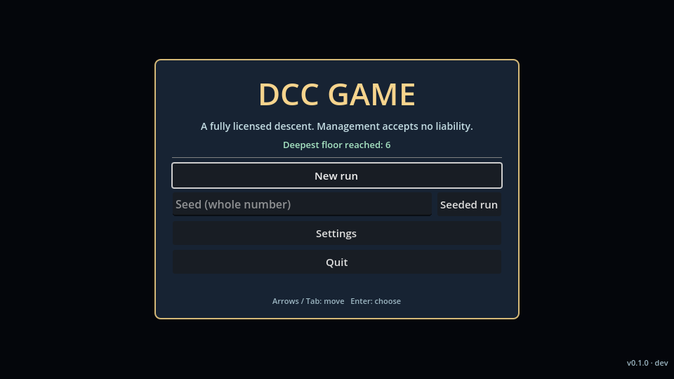
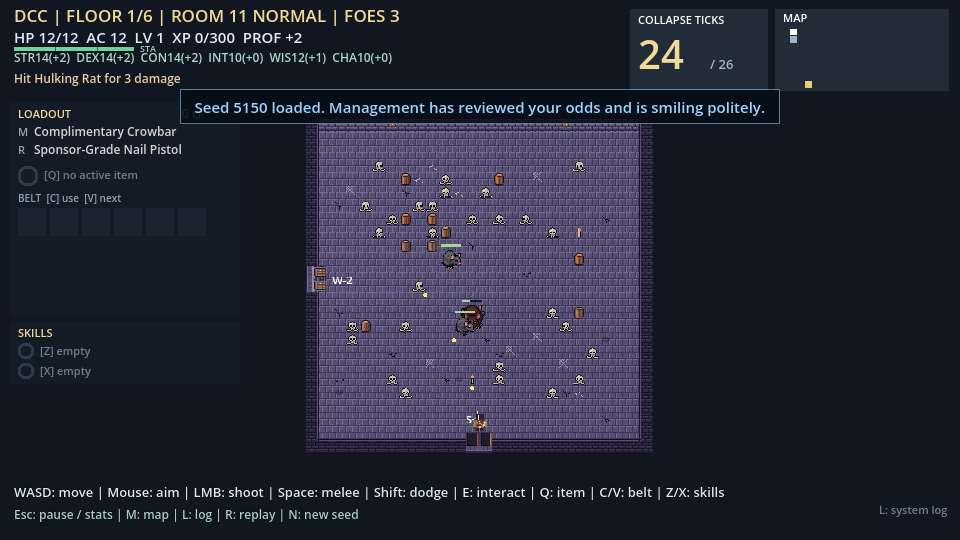
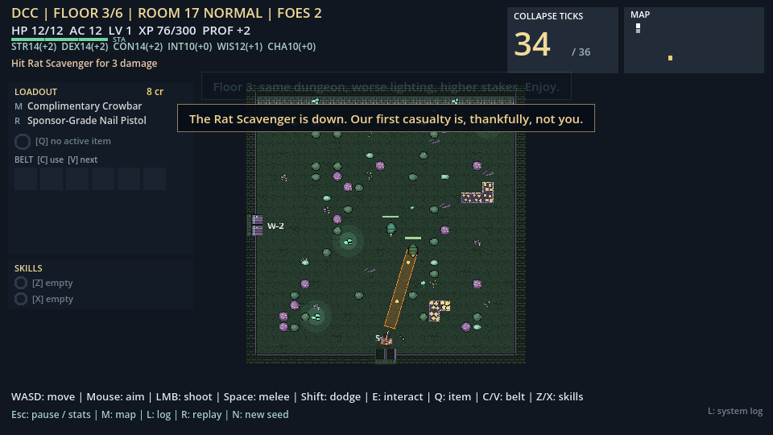
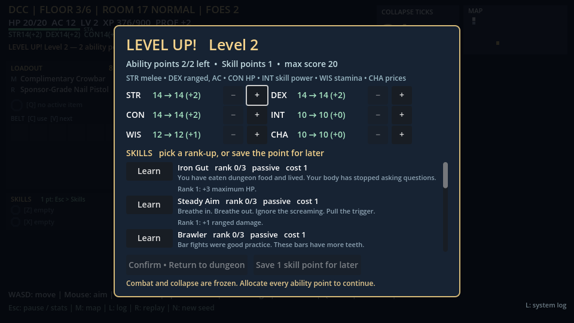

# DCC Game

DCC Game is a top-down, room-by-room roguelite. You play a **crawler** who goes down through procedurally generated dungeon floors while a **collapse clock** counts down. A cheerful, indifferent dungeon **System** narrates it all like a game show that doesn't much mind whether you survive. The premise comes from the "the dungeon is a game show" idea in LitRPG dungeon-crawler fiction. Everything in the game is original: the names, the writing, the enemies, the items and the generated art. No book text or characters are used.

It is built in **Godot 4.7.2 (GDScript)** for desktop PC. The game is playable from start to finish: you can win or lose a six-floor run. Most art and all audio are **placeholders**, and balance has not been playtested yet (see [Status and limitations](#status-and-limitations)).

| | |
| --- | --- |
|  |  |
| Title screen | Stone crypt, floor 1 |
|  |  |
| Fungal cavern, floor 3 | Level-up: stats and skills |

*Screenshots are real 1× (960×540) captures from the game, made with [`tools/screenshot.gd`](tools/screenshot.gd) on seed 5150.*

## Features

- **Descend six floors.** Each floor is a seeded graph of 22–44 rooms, with branches, loops and special side rooms (treasure, elite, trap, shrine, guild hall). To leave a floor you beat its boss and then take the exit. A short intermission comes between floors, and clearing floor 6 wins the run. Every outcome ends on a run summary that shows the seed.
- **The collapse clock.** Entering a new room costs ticks, and each door shows its cost before you go through. Guild halls, shrines and elite clears give ticks back. When the clock hits zero you get a 10-second **grace period** with falling debris. Regaining ticks stabilises the floor; otherwise it collapses on you. Fights **seal the doors** until the room is cleared.
- **Enemies.** There are 12: 10 normal enemies in seven roles (chaser, ranged, charger, zoner, summoner, tank, support), plus two phased bosses. Elite variants carry *bulwark* or *volatile* modifiers. Each attack has a visible wind-up **telegraph**, and the number of enemies in a room grows with depth.
- **d20 action combat.** You aim in any direction and fight with melee (arc, thrust or spin) and ranged attacks (single, spread, burst or beam). Hits are d20 rolls against AC, using six ability scores, proficiency and damage dice. There is also a dodge roll with invulnerability frames and stamina, knockback, hit-stop, screen shake and floating damage numbers.
- **Levels and skills.** Each level gives 2 ability points and 1 skill point. The skill tree has 8 skills with ranks and prerequisites. Up to two active skills sit in slots bound to Z / X (LT / X on a gamepad), with cooldowns. INT increases skill power.
- **Items and loot.** There are 10 weapons, 4 active items, 10 passives, 6 consumables on a 6-slot belt and 9 status effects, all driven by an effect model defined in data. Loot comes from chests, room clears and boss loot boxes. You earn credits and spend them in the guild-hall shop, where CHA lowers prices.
- **Biomes.** Floors 1–2 are a stone crypt, floors 3–4 a fungal cavern (poison spore clouds, slowing puddles), and guild halls have their own interior. All three use generated tile art. Floors 5–6 use tinted crypt art until their own art exists.
- **The System.** An announcer pops up toasts and keeps a log of 200+ original lines. There are 23 achievements, a lifetime profile, and a telemetry report saved after every run.
- **Generated audio.** 38 sound effects, ambient loops and music tracks are synthesised by a script and play on Music, SFX, Ambient and UI buses with their own volume sliders.
- **Companion (prototype, off by default).** The Scrap Hound follows you, picks targets and bites, can be downed and revived, and can be told to stay. Turn it on with `companion.enabled` or **F8**.
- **Settings, controls and accessibility.** Full keyboard + mouse or gamepad play, with aiming switched by whichever device you used last and optional gamepad aim assist. Every action can be **remapped**. There are also text scale (1.0 / 1.25 / 1.5), high contrast, reduced flash, patterned colour-blind telegraphs, volume sliders, and resolution / fullscreen options.

## How to play

On each floor, find and beat the **boss** (the red room on the map), then reach the **exit** (the gold room) before the clock runs out. Explore more rooms for loot and XP, but every new room costs ticks.

| Keyboard / mouse | Gamepad | Action |
| --- | --- | --- |
| WASD / arrow keys | Left stick | Move |
| Mouse | Right stick | Aim (whichever device you used last) |
| Left mouse (hold) | RT (hold) | Shoot |
| Space (hold) | RB (hold) | Melee |
| Shift | B | Dodge roll |
| E | A | Interact: chest, shrine, rest, shop, pick up |
| Q | LB | Use the active item |
| C / V | D-pad down / right | Use / select a belt consumable |
| Z / X | LT / X | Active skill 1 / 2 |
| M | Back | Floor map |
| L | L3 | System log |
| Esc | Start | Pause: stats, inventory, skills, achievements, settings |
| R / N | — | Restart with the same seed / a new seed |

All of these can be rebound under **Settings → Remap controls…** (saved to `user://settings.cfg`). Menus work with the keyboard alone (arrows / Tab, Enter, Esc) or the gamepad alone (D-pad, A, B). F9 (give a level) and F8 (toggle the companion) are developer keys. Tab / Y is reserved for a future weapon swap. The full table, aiming rules and accessibility keys are in [`game/README.md`](game/README.md#input-and-accessibility).

## Run, test and build

**Play from source.** Install [Godot 4.7.2 stable, the standard (non-.NET) build](https://godotengine.org/download/archive/4.7.2-stable/). In the Project Manager, choose **Import → `game/project.godot`**, then press **F5**.

**Run the tests** (headless; about two minutes):

```sh
GODOT=/path/to/godot bash game/tests/run_all.sh --clean
```

This runs the import step, a compile check of every script, 23 test suites and a short launch of the main scene. `--clean` deletes `game/.godot` first. Use it if a step crashes with exit code 139 (a stale import cache after new audio assets).

**CI.** [`.github/workflows/godot-ci.yml`](.github/workflows/godot-ci.yml) runs the same script (with `--clean`) on pull requests and on pushes to `main` that touch `game/` or `tools/`.

**Builds.** [`game/export_presets.cfg`](game/export_presets.cfg) defines **Linux x86_64**, **Windows x86_64** and an **unsigned universal macOS** zip, each with the game data packed into the binary. You need the 4.7.2 export templates installed. Then:

```sh
mkdir -p builds/linux builds/windows
python3 tools/stamp_version.py                     # writes game/version.json {version, commit, built_at}
godot --headless --path game --export-release "Linux x86_64" ../builds/linux/dcc-game
godot --headless --path game --export-release "Windows x86_64" ../builds/windows/dcc-game.exe
python3 tools/stamp_version.py --reset             # back to the committed "dev" default
```

The title screen shows `v<version> · <commit>` in the bottom-right corner. The version comes from `config/version` in `game/project.godot`; the commit is stamped at build time and reads `dev` in source builds.

**Cutting a release.** Bump `config/version` in `game/project.godot`, merge, then push a matching tag:

```sh
git tag v0.1.0 && git push origin v0.1.0
```

[`.github/workflows/godot-export.yml`](.github/workflows/godot-export.yml) then:
1. Checks that the tag matches `config/version`.
2. Runs the tests.
3. Stamps the version.
4. Exports all three platforms.
5. Smoke-launches the Linux build.
6. Uploads the zips.
7. Opens a **draft** GitHub Release for a person to review and publish (see [Rights and licensing](#rights-and-licensing)).

You can also run the export by hand with *Run workflow* to get the zips as workflow artifacts without making a release.

**Regenerating placeholder assets.** All of these scripts are deterministic and need Python 3; the first three also need Pillow:
- `python3 tools/gen_biome_tileset.py`: biome tile atlases
- `tools/gen_placeholder_sprites.py`: enemy and companion sprites
- `tools/gen_icon.py`: the app icon
- `tools/gen_sfx.py`: all audio (standard library only)

## Repository map

```text
README.md                  this file
game/                      the Godot project (engineering reference: game/README.md)
  project.godot            settings, autoloads, Input Map, version, icon
  export_presets.cfg       Linux / Windows / macOS export presets
  version.json             build stamp (committed default: commit "dev")
  scenes/Main.tscn         the single scene; Game builds everything else in code
  scripts/                 game logic: core/ (autoloads, settings, input), content/, ui/
  data/                    JSON: rules, enemies, biomes, announcer, audio, achievements, companions,
                           content/ (weapons, items, skills, effects, loot tables)
  assets/                  biomes/, characters/, enemies/, audio/, ui/ (see assets/README.md)
  tests/                   run_all.sh and the *_test.gd suites
tools/                     asset generators, stamp_version.py, screenshot.gd
docs/                      roadmap, design docs, decisions, plans, research, art mock-ups and screenshots
data/canon/                schema for the research catalogue (empty apart from an example record)
.github/workflows/         godot-ci.yml (tests), godot-export.yml (builds and releases)
```

## Design documents

| Document | Covers |
| --- | --- |
| [Roadmap](docs/ROADMAP.md) | Vision, decision log D-01…D-19, what exists, next milestones, risks |
| [Game design](docs/design/GAME_DESIGN.md) | Run loop, what persists, intermission, summary, screen flow, the System, scope and IP |
| [Collapse system](docs/design/COLLAPSE_SYSTEM.md) | Ticks, budgets by depth, room-type policies, the grace period, feasibility |
| [Combat and RPG](docs/design/COMBAT_AND_RPG.md) | Input and accessibility, dodge, melee and ranged, damage pipeline, statuses, door lock, skills, inventory, companions |
| [Content rules](docs/design/CONTENT_RULES.md) | Weapons, items, skills, effects, statuses, loot tables as data |
| [Procedural generation](docs/design/PROCEDURAL_GENERATION.md) | Floor graph, depth scaling, special rooms, feasibility, map, biome assignment |
| [Enemy tiers](docs/design/ENEMY_TIERS.md) and [encounter rules](docs/design/ENCOUNTER_RULES.md) | Roles, bands, guardrails, roster, elites, bosses, threat budgets, spawns |
| [Biomes and tilesets](docs/design/BIOMES_AND_TILESETS.md) | Six-biome catalogue, the 16×16 atlas standard, mock-ups |
| [Room, enemy and RPG prototype spec](docs/design/ROOM_ENEMY_RPG_PROTOTYPE.md) | Fixed 24×24 rooms, obstacles, enemy JSON, d20 rules |
| [ADR-001](docs/decisions/ADR-001-engine-and-platform.md) | Engine and platform decision (Godot 4.7.2, GDScript) |
| [Full-game plan](docs/plans/2026-10-25-full-game-plan.md) | The three waves of pull requests that built the current game, with outcomes |
| [Catalogue guide](docs/research/CATALOG_GUIDE.md) and [source index](docs/research/SOURCE_INDEX.md) | Rules for research notes: citations, spoilers, canon vs adapted vs original |

## Status and limitations

- **Placeholder art and audio.** The biome tiles (apart from the crypt sampler), most enemy sprites, the companion, the icon and every sound are generated stand-ins. Characters have eight facing poses but no walk or attack animations.
- **No mid-run saves.** Only settings, the profile (achievements, lifetime stats) and telemetry persist. Quitting ends the run.
- **Balance is untested.** Clock budgets, enemy numbers, loot rates and skill values come from the design docs and automated checks, not from playtesting.
- **Partial biome coverage.** Two dungeon biomes and the guild interior have art. Floors 5–6 reuse tinted crypt art, and there are no new biome hazards after floor 4.
- **Not built yet:** the companion is a flagged prototype, and there are no classes, no meta-progression and no weapon swap.
- **CI is paused.** GitHub Actions is billing-blocked on this repository until that is fixed. Both workflows are written and checked, and the tests and a Linux export pass locally, but neither workflow has run on GitHub yet.
- **Saved data has moved.** Settings and the profile live under Godot's `app_userdata/DCC Game/` folder. The project was renamed from "DCC Game — Technical Prototype", so data saved under the old name is not picked up.

## Rights and licensing

- **No licence file yet.** The repository has none, so all rights are reserved by the owner unless a licence is added.
- **Original content.** Game text, names, enemies, items and generated art and audio are original to this project. The generated WAVs may be treated as CC0 ([`game/assets/audio/README.md`](game/assets/audio/README.md)).
- **Stone crypt sampler caveat.** The stone crypt's base tiles (`stone_crypt/tileset_16x16.png`, copied into rows 0–1 of `tileset_16x16_full.png`) come from a free 16×16 dungeon tile sampler the owner supplied. That sampler grants no explicit licence or right to redistribute. The crawler and rat sheets were also supplied by the owner. Confirm the rights before any public release; `stone_crypt/tileset_16x16_original.png` is an all-generated stand-in for the crypt tiles. See [`game/assets/README.md`](game/assets/README.md).
- **IP.** The project grew out of research notes on an existing copyrighted book series. The design keeps all game-facing expression original. Any public or commercial release still needs the IP review described in D-12 ([GAME_DESIGN.md §9](docs/design/GAME_DESIGN.md#9-scope-and-ip--d-12)). This repository grants no rights to anyone else's characters, settings, names or artwork.
