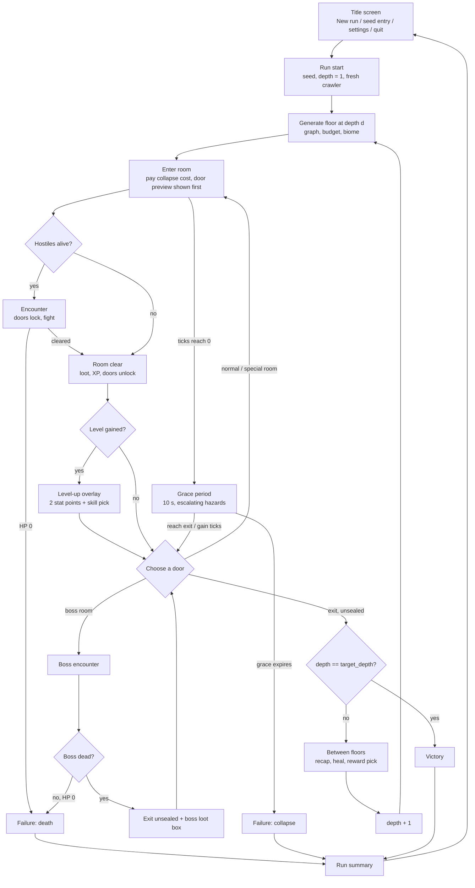

# Game Design — the run loop contract

- **Status:** Proposed (design baseline for the Wave 2 vertical slice). Sections marked *Current prototype* describe code that is implemented in `game/scripts/`.
- **Last updated:** 2026-10-25
- **Roadmap:** Phase 1A, backlog task 1 ("write the game loop contract")
- **Decisions covered:** D-08 (persistence), D-12 (distribution scope); points to D-03/D-04/D-05 in [COLLAPSE_SYSTEM.md](COLLAPSE_SYSTEM.md)
- **Related:** [Collapse system](COLLAPSE_SYSTEM.md) · [Combat and RPG](COMBAT_AND_RPG.md) · [Procedural generation](PROCEDURAL_GENERATION.md) · [Enemy tiers](ENEMY_TIERS.md) · [Encounter rules](ENCOUNTER_RULES.md) · [Biomes](BIOMES_AND_TILESETS.md) · [Roadmap](../ROADMAP.md) · [Build-out plan](../plans/2026-10-25-full-game-plan.md)

This page is the contract the run-loop, UI and announcer work (Wave 2A, 2G) builds against. Every number is a default that lives in data (`game/data/*.json` or the RunState config), not in scene code.

**Architecture this page assumes (Wave 1A):**

| Piece | Role |
| --- | --- |
| `game.gd` | The orchestrator: owns the state machine (§7), generates floors and handles room transitions |
| `RunState` autoload (`core/run_state.gd`) | All run data: seed, depth, floor, ticks and the tick ledger, XP, level, ability scores, HP, inventory, skills, visited rooms, room states, telemetry, `summary()` |
| `Events` autoload (`core/events.gd`) | The signal bus that UI, audio, announcer, items and skills listen to: `run_started`, `floor_started`, `room_entered`, `room_cleared`, `ticks_changed`, `boss_defeated`, `floor_cleared`, `run_ended`, combat signals and `message` |
| `player.gd`, `combat.gd`, `room_renderer.gd`, `ui/hud.gd` | Movement and input; damage; drawing; HUD |

New loop features add states to `game.gd`, data to `RunState`, and signals to `Events`. Presentation layers only subscribe.

## 1. Vocabulary

| Term | Definition |
| --- | --- |
| **Run** | One attempt from the title screen to a run summary. Owns the run seed, depth, character build, inventory, telemetry and outcome. |
| **Floor** | One procedurally generated room graph at a given **depth** (1 = first floor). Owns its own collapse budget, map discovery and room states. |
| **Room** | One node of the floor graph. Always a fixed 24×24-tile (384×384 world px) interior with up to four cardinal doors (D-16). Has a **kind** (`start`, `normal`, `boss`, `exit`, `guild_hall`, plus the special kinds in [PROCEDURAL_GENERATION.md](PROCEDURAL_GENERATION.md)). |
| **Encounter** | The hostile population of a room, generated once per room from the encounter tables and threat budget ([ENCOUNTER_RULES.md](ENCOUNTER_RULES.md)). Persists for the life of the floor. |
| **Boss** | The single enemy flagged `rank: "boss"` in the boss room. Killing it unseals the exit. |
| **Exit** | The stairs room. Entering it after the boss is dead ends the floor successfully. |
| **Collapse** | The floor's countdown, measured in **ticks** and spent on room transitions. At zero the floor enters a grace period and then collapses ([COLLAPSE_SYSTEM.md](COLLAPSE_SYSTEM.md)). |
| **Crawler** | The player character. Use this word in UI text; never a character name from the books. |

## 2. Current prototype behaviour

This is the behaviour at main @ 9bb993d, which the Wave 1A refactor preserved.

- One floor per run. The HUD always shows `FLOOR 1`. `room_count` 22, `start_ticks` 26 and the seed 424242 come from [`prototype_rules.json`](../../game/data/prototype_rules.json).
- Outcomes (`RunState.outcome`) are `running`, `collapsed`, `escaped` and `defeated`. When the run ends, a banner shows rooms entered, level and XP; `RunState.end_run()` emits `Events.run_ended(outcome, summary)`. **R** repeats the seed and **N** rolls a new one. There is no title screen and no summary screen; `game.gd` has the states `RUNNING`, `LEVEL_UP`, `PAUSED` and `ENDED`.
- The exit is sealed until the enemy with id `armored_brute` dies. The check is hard-coded to that id (`game.gd` `BOSS_DEFINITION`); it is not a data flag.
- Entering a room spends ticks according to the room-kind policy. If the clock reaches 0 on a transition, the run ends at once with `collapsed`, and this check happens *before* the exit check (see the edge case in [COLLAPSE_SYSTEM.md §2](COLLAPSE_SYSTEM.md#2-current-prototype-behaviour)).
- Room states (obstacles, surviving enemies) persist across revisits in `RunState.room_states`. Projectiles are cleared on every transition.
- Level-up and Esc pause are modal overlays that freeze simulation. The collapse clock never changes while they are open.
- Death resets everything. Nothing is saved.

## 3. The loop

### 3.1 Run

- **Start:** the title screen offers *New run* with an optional seed field; leave it empty for a random seed. Seeds are 31-bit positive integers shown on every summary.
- **Floor seed derivation (determinism):** use `RunState.floor_seed(depth)`, as implemented in 1A. Depth 1 uses the run seed unchanged, so existing seeds reproduce. Deeper floors use `(run_seed + (depth − 1) × 1000003) mod 2147483647`, which 1A marks as provisional; this page adopts it as the default. Every per-room RNG keeps the existing `seed + room_id × k` pattern on top of the floor seed. With the same run seed and the same choices, a player gets the same floors.
- **Proposed default — victory:** the run is won when the crawler takes the unsealed exit on floor **`target_depth` = 6** (config key `run.target_depth`). Six floors cover bands I–III ([ENEMY_TIERS.md](ENEMY_TIERS.md)) and three biomes ([BIOMES_AND_TILESETS.md](BIOMES_AND_TILESETS.md)). Target run length is 45–60 minutes.
- **Failure:** (a) **death**, when HP reaches 0; (b) **collapse**, when the grace period expires; (c) **abandon**, chosen from the pause menu, which is recorded as a failure with cause `abandoned`.
- An *endless* mode after floor 6 is out of scope for the slice. Reserve it as `run.mode = "endless"`.

### 3.2 Floor

1. `RunState.reset_for_floor(depth)` clears the per-floor state, then `game.gd` generates the graph for `(RunState.floor_seed(), room_count(depth))` ([PROCEDURAL_GENERATION.md](PROCEDURAL_GENERATION.md)) and emits `Events.floor_started(depth, floor)`.
2. Compute the collapse budget from the mandatory route plus depth slack ([COLLAPSE_SYSTEM.md §4](COLLAPSE_SYSTEM.md#4-starting-budget-and-depth-scaling)), and set `RunState.ticks` to it. Today `reset_for_floor` keeps the old ticks, so 2A must set the new budget here.
3. Assign the biome for the depth. Place the crawler at the centre of the start room. Reveal the start, boss and exit positions on the minimap.
4. Roll the `floor_start` loot table (1B: one cheap consumable care package, [CONTENT_RULES.md §7](CONTENT_RULES.md#7-loot-tables-loot_tablesjson)).
5. The announcer plays its floor-intro line, and play begins.

The floor ends with **exit** (success), **death** or **collapse**.

### 3.3 Room

- **Before entry:** each door shows the net tick change for the room behind it, plus a kind colour for scouted rooms. This is implemented as a label like `E-2` and tinted doors.
- **On entry:** pay the cost. If the room has living hostiles and its kind locks (D-07, [COMBAT_AND_RPG.md §9](COMBAT_AND_RPG.md#9-d-07--door-lock-and-room-persistence)), the doors close 0.5 s after the crawler is 24 px inside the room. Enemies are dormant for 0.6 s after entry.
- **Clear:** when the last non-trap hostile dies, the doors unlock and a short "room clear" sting plays. Room rewards drop at this point (see [ENCOUNTER_RULES.md §7](ENCOUNTER_RULES.md#7-rewards)).
- **Revisit:** free under the default policy, with no respawns. Pickups that were left behind remain on the floor.

### 3.4 Boss and exit

- The boss room is the second-to-last room of the guaranteed spine, and the exit is the last (this is the generator's current behaviour). The exit stays sealed until the boss is dead. A sealed exit door is drawn red and its tooltip reads *Sealed: defeat the floor boss*.
- A boss kill (`Events.boss_defeated`) drops a **boss loot box**. It rolls the 1B `boss_kill` table, which gives 2 distinct rewards that are never common, plus 1 extra roll at CHA mod ≥ +3 ([ENCOUNTER_RULES.md §7](ENCOUNTER_RULES.md#7-rewards)). The box opens in a modal reward overlay, like level-up, that shows what came out; it is not a choice.
- **Rule change from the prototype:** entering the unsealed exit always succeeds, even when paying its cost would reduce the clock to 0. Exit resolution happens before collapse resolution.

## 4. What persists — D-08

**Proposed default (D-08): full reset per run, with reserved unlock hooks.**

| Thing | Between rooms (same floor) | Between floors (same run) | Between runs |
| --- | --- | --- | --- |
| HP | persists | persists, then heals 50 % of *missing* HP at the intermission | reset |
| XP, level, ability scores, skills | persist | persist | reset |
| Inventory (weapons, active, passives, consumables) | persists | persists | reset |
| Stamina, cooldowns, statuses | persist (statuses keep ticking) | stamina refilled, cooldowns reset, statuses cleared | reset |
| Collapse ticks | persist | new floor budget; leftover ticks **do not** carry over (converted, see §5) | reset |
| Room states, map discovery | persist | discarded | — |
| Achievements, lifetime stats | — | — | **persist** in `user://profile.json` (presentation only) |
| Unlocks | — | — | **reserved**: `RunState.meta.unlocks: Array[String]`, always empty in the slice |

Implementation note for 2A: `RunState.start_run(seed)` (implemented) already resets XP, scores, HP, inventory, skills, the ledger and telemetry, and `reset_for_floor(depth)` clears the per-floor state. 2A adds:

- `RunState.meta`, loaded from `user://profile.json`. `start_run` never touches it.
- A no-op hook, `apply_meta_unlocks()`, called at the end of `start_run`, so that later meta-progression needs no change to the call sites.
- The between-floor rules in this table (heal, refill stamina, clear statuses, new tick budget) applied by a `RunState.begin_next_floor(depth)` wrapper.

## 5. Between floors (the intermission)

The intermission is a non-combat modal screen that is shown after the exit and before the next floor is generated. Gameplay time is frozen during it.

1. **Floor recap:** rooms explored / total, ticks spent / granted / left, kills, damage taken, and loot picked up.
2. **Leftover ticks:** each leftover tick converts to **+10 XP × depth**, capped at +100 XP × depth. This is presented as an "efficiency bonus". It deliberately stays small, so that exploring is still worth more than hoarding (see [COLLAPSE_SYSTEM.md §10](COLLAPSE_SYSTEM.md#10-anti-patterns-and-safeguards)).
3. **Heal:** restore 50 % of missing HP, rounded up.
4. **Announcer:** one sardonic line keyed to how the floor went (fast, slow, near-death, near-collapse).
5. **Descend** button. The next floor generates and the intermission fades out on the new start room.

Level-ups earned from the efficiency bonus open the level-up overlay before the Descend button becomes active.

## 6. Run summary

The summary is shown for every outcome. Its data is `RunState.summary()`, the snapshot carried by `Events.run_ended(outcome, summary)`. 2A and 2G extend it with the fields below, and 2G writes it to `user://telemetry/run_<seed>_<timestamp>.json`.

| Block | Contents |
| --- | --- |
| Header | Outcome (Victory / Died / Collapsed / Abandoned), cause (killer enemy id, or "collapse on floor N", or "abandoned"), depth reached, run time, seed |
| Per floor | Rooms explored / total, mandatory route cost, start budget, ticks spent / granted / left, grace triggered (y/n) |
| Combat | Kills by archetype, elites and bosses killed, damage dealt / taken, dodges, accuracy (hits / attacks) |
| Build | Level, six ability scores, skills taken, equipped weapons and active item, passives, consumables used |
| Loot | Items collected (by rarity), loot boxes opened |
| Achievements | Earned this run (new ones highlighted) |
| Epitaph | One announcer line chosen by outcome and cause |
| Actions | **Retry seed** · **New run** · **Title** |

## 7. Screen flow and game states

These are the states of the `game.gd` state machine. `RUNNING`, `LEVEL_UP`, `PAUSED` and `ENDED` exist today. 2A adds `TITLE` and `SUMMARY` (`SUMMARY` replaces today's `ENDED` banner), plus the proposed `REWARD_PICK` and `INTERMISSION`. Overlays freeze simulation and never change the collapse clock. Every transition emits a signal on `Events` so that UI and audio can follow without polling.

| State | Enters from | Leaves to | Simulation | Status |
| --- | --- | --- | --- | --- |
| `TITLE` | boot, summary | `RUNNING` (`RunState.start_run`, `Events.run_started`) | none | 2A |
| `RUNNING` | title, overlays, intermission | `PAUSED`, `LEVEL_UP`, `REWARD_PICK`, `INTERMISSION`, `SUMMARY` | live | exists |
| grace (a flag on `RUNNING`, `RunState.grace_left > 0`) | ticks reach 0 | normal running (ticks regained), `INTERMISSION` (exit), `SUMMARY` (collapse or death) | live, grace timer counting | 2E |
| `PAUSED` | `pause` | `RUNNING`, `SUMMARY` (abandon, after confirmation) | frozen | exists |
| `LEVEL_UP` | `Events.level_up` | `RUNNING` (cannot be skipped, as today) | frozen | exists |
| `REWARD_PICK` | boss kill, loot box, chest | `RUNNING` | frozen | proposed (2B) |
| `INTERMISSION` | exit taken, depth < target (`Events.floor_cleared`) | `RUNNING` (new floor, `Events.floor_started`) | frozen | proposed (2A) |
| `SUMMARY` (today `ENDED`) | victory, death, collapse, abandon (`Events.run_ended`) | `TITLE`, `RUNNING` (retry / new) | none | 2A |

The pause menu keeps the current pages (overview, character, resolution). 2B adds an *Inventory* page and 2F a *Skills* page. Abandon asks for confirmation.

## 8. The dungeon system announcer (presentation layer)

The fiction is that the dungeon is run by an indifferent, game-show-like **system**. It narrates the crawl, hands out achievements and loot boxes, and comments on the crawler's choices with dry, sardonic humour. **It is a presentation layer only**: it reacts to `Events` signals and never changes game state.

- **Original content only.** No characters, catchphrases, dialogue or passages from the books. Lines are written for this project and live in JSON (2G owns the file, for example `data/content/announcer.json`), keyed by event.
- **Tone guide:** a bureaucratic, overly cheerful corporate voice delivering bad news. Short, two lines at most, 90 characters per line. Punch at the situation, never at the player's real-world identity. No slurs and no sexual content.
- **Channels:** a toast (top centre, 2.5 s) for events, and a scrolling log on the pause screen. Toasts never cover the room interior's middle 60 %, and they never block input.
- **Rate limit:** at most one toast per 4 s. Priority events (boss intro, grace start, death) pre-empt and are never dropped.
- **Events that need lines (minimum 3 variants each).** The announcer subscribes to `Events`; it never polls `RunState`, apart from reading values for line templates.

  | Line key | Signal |
  | --- | --- |
  | `run_started`, `floor_started`, `boss_killed`, `level_up` | the existing `run_started`, `floor_started`, `boss_defeated` and `level_up` |
  | `first_kill` | the first `enemy_killed` |
  | `ticks_low` (≤ 4) | `ticks_changed` |
  | `room_cleared_flawless` | `room_cleared` with no `player_damaged` since `room_entered` |
  | `death` | `player_died` |
  | `collapse`, `victory` | `run_ended` |
  | `elite_spotted`, `boss_intro`, `grace_started`, `loot_box_opened`, `achievement` | **new signals** proposed for 2C, 2E, 2B and 2G: `elite_spotted`, `boss_phase_changed`, `grace_started` / `grace_ended`, `loot_box_opened`, `achievement_unlocked` |

  Toasts are shown through the existing `Events.message(text, category)` channel, with `category: "announcer"`.
- **Achievements:** data-defined (`id`, `title`, `quip`, `condition` as an event counter). The slice needs 12. Examples of the shape, written for this project: *"Door Enthusiast — Opened 25 doors. The doors have filed a complaint."* · *"Exact Change — Reached the exit with 0 ticks to spare."*
- **Sample line register** (original): *"Floor 3. Management reminds you that the ceiling is load-bearing, mostly."*

## 9. Scope and IP — D-12

**Proposed default (D-12):** this is a private, non-commercial fan prototype. No exported builds are distributed outside the project team until an IP review has happened, and the source repository must not contain book text. All names, enemies, items, lines and art made for the game are original. A book concept may inspire a mechanic only through the catalogue's `adapted` path ([CATALOG_GUIDE.md](../research/CATALOG_GUIDE.md)). The third-party sampler art keeps its redistribution caveat ([assets README](../../game/assets/README.md)).

## 10. Pacing targets (for telemetry checks)

| Measure | Floor 1 | Floor 3 | Floor 6 |
| --- | --- | --- | --- |
| Rooms on floor (D-06) | 22 | 30 | 44 |
| Rooms explored (median target) | 13–16 | 17–21 | 24–28 |
| Floor time (median target) | 5–7 min | 7–9 min | 9–12 min |
| Crawler level at floor end | 3 | 4–5 | 7 |
| Runs reaching this depth (target) | 100 % start | ~55 % | ~20 % win |

If telemetry misses these bands by more than 25 %, tune `room_count`, the slack ratio and encounter budgets in that order.

## 11. Open questions

1. Should victory at floor 6 offer "continue deeper" (endless) or end the run? (Default: end the run; endless comes later.)
2. Should the intermission offer a shop or guild visit, or stay a single reward pick? (Default: reward pick only; guild hall services are on-floor.)
3. Should the efficiency bonus be XP or a currency once a currency exists? (Default: XP.)
4. Should *Abandon* count toward achievements and lifetime stats? (Default: lifetime stats yes, achievements no.)
5. What meta unlocks, if any, come after the slice (D-08 follow-up)? Candidates: starting-weapon choice and cosmetic crawler palettes. No power unlocks before balance data exists.
6. Should runs support save-and-quit mid-floor? (Default: no for the slice; save only between floors later.)
